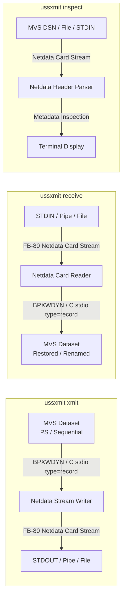
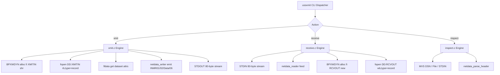

# Architecture & Technical Design: `ussxmit`

## 1. Architectural Goals & System Context

`ussxmit` provides native z/OS UNIX System Services (USS) command-line tooling to package datasets into standard TSO XMIT format and unpack XMIT data streams back into MVS datasets with **zero temporary DASD staging**.



---

## 2. Command Line Interface Design

The single executable [`ussxmit`](src/main.c:1) inspects `argv[0]` or the first positional argument (`argv[1]`):

```
ussxmit <action> [options] [dsname]
```

### Action Dispatch Rules
1. **Direct Action Argument**:
   - `ussxmit xmit <source-dsn>`: Translates to XMIT generation mode.
   - `ussxmit receive [target-dsn]`: Translates to RECEIVE restoration mode.
   - `ussxmit inspect [source-dsn]`: Translates to archive inspection mode.
2. **Symlink / Base Name Invocation**:
   - If `argv[0]` basename is `xmit`, defaults action to `xmit` and parses arguments from `argv[1]`.
   - If `argv[0]` basename is `receive`, defaults action to `receive` and parses arguments from `argv[1]`.
3. **Options**:
   - `-f`, `--force`: Overwrite existing target dataset on receive if already cataloged.
   - `-l`, `--list`: List/inspect metadata only (synonym for `inspect`).
   - `-v`, `--verbose`: Enable verbose diagnostic logging to `stderr`.
   - `-q`, `--quiet`: Suppress non-error informational messages.
   - `-h`, `--help`: Display synopsis and options.
   - `-V`, `--version`: Show version string.

---

## 3. The TSO XMIT / Netdata Format Specification

TSO XMIT archives use the **IBM Netdata format** structured as fixed 80-byte physical records (`RECFM=FB, LRECL=80`).

### 3.1. Physical Card Framing & Continuous Segment Packing
In standard Netdata format:
- Every physical record is an 80-byte card image.
- Data and control records are broken into segments. Each segment begins with a 2-byte header:
  - **Byte 0 (`seg_len`)**: Length of the segment (including the 2-byte header), from `2` up to `255`.
  - **Byte 1 (`flags`)**: Segment control flags.
  - **Bytes 2..(`seg_len` - 1)**: Segment payload.
- Segments are packed continuously across 80-byte card boundaries without inter-segment padding until the archive trailer or EOF.
- When the stream ends, the final 80-byte card is padded to column 80 with EBCDIC space (`0x40`) or binary zeros (`0x00`).

### 3.2. Segment Control Flags
The segment control byte governs record reassembly:
- `0x80`: First segment of a spanned logical record.
- `0x40`: Last segment of a spanned logical record.
- `0x20`: Control record indicator.
- `0xC0` (`0x80 | 0x40`): Complete standalone data record (single-segment logical record).
- `0xE0` (`0x80 | 0x40 | 0x20`): Complete standalone control record (`INMR01`, `INMR02`, `INMR06`).
- `0xA0` (`0x80 | 0x20`): First segment of a spanned control record.
- `0x60` (`0x40 | 0x20`): Last segment of a spanned control record.
- `0x00`: Middle segment of a spanned data record.

### 3.3. Logical Control Records (EBCDIC Eyecatchers)

All control records are identified by a 6-byte EBCDIC eyecatcher:

| Identifier | Name | Purpose |
|:---|:---|:---|
| `INMR01` | Header Record | Origin node, user ID, target node, user ID, timestamp, transmission version, utility name (`INMCOPY` / `IEBCOPY`). |
| `INMR02` | Dataset Utility Record | 4-byte file number (`0x00000001`), dataset organization (`INMDSORG`), record format (`INMRECFM`), `INMLRECL`, `INMBLKSIZE`, allocation units, directory blocks (`INMDIR`), dataset name qualifiers (`INMDSNAM`). |
| `INMR03` | User Control Record | Optional transmission messages, notes, and user-specified text units. |
| `INMR06` | Trailer Record | End-of-transmission delimiter; records total data record count. |

### 3.4. Text Units (KLD Structures)

Control records structure their attributes using Key-Length-Data (KLD) tuples:
- **Key** (2 bytes, big-endian): Identifies the attribute (e.g., `INMDSNAM = 0x0002`, `INMLRECL = 0x0042`).
- **Count** (2 bytes, big-endian): Number of length-data pairs.
- For each item:
  - **Length** (2 bytes, big-endian): Length of the subsequent value.
  - **Value** (`Length` bytes): Variable length byte string or integer.

Key text units defined in [`include/netdata.h`](include/netdata.h:1):
- `INMDSNAM` (`0x0002`): Dataset name qualifiers.
- `INMMBR`   (`0x0003`): Member name.
- `INMDIR`   (`0x000B`): Directory block count (for PDS).
- `INMEXPDT` (`0x0022`): Expiration date.
- `INMTERM`  (`0x0028`): Terminal transmission flag.
- `INMUTILN` (`0x002B` / `0x1028`): Utility program name (`INMCOPY` / `IEBCOPY`).
- `INMSIZE`  (`0x0030`): Dataset size estimate.
- `INMDSORG` (`0x003C`): Dataset organization (`0x4000` = PS, `0x0200` = PO).
- `INMRECFM` (`0x0049`): Record format (`0x80` = Fixed, `0x40` = Variable, `0x10` = Blocked, etc.).
- `INMLRECL` (`0x0042`): Logical record length.
- `INMBLKSIZE` (`0x0030`): Physical block size.

---

## 4. Pure In-Process Execution Architecture

`ussxmit` eliminates scratch disk staging by combining dynamic allocation with native C record I/O and continuous stream encoding:



### 4.1. `xmit` Operation
1. Normalizes the source dataset name (`CCW.TESTSEQ` -> `CCW.TESTSEQ`).
2. Calls `dynalloc_str("alloc fi(XMITIN) da('...') shr")` to dynamically allocate the dataset via SVC 6 `BPXWDYN`.
3. Opens the dataset using `fopen("DD:XMITIN", "rb,type=record")` for native binary record I/O.
4. Queries dataset characteristics using `fldata()` to extract `dsorg`, `recfm`, `maxreclen`, and `blksize`.
5. Initializes `netdata_writer_t` bound to `stdout`.
6. Emits `INMR01` transmission header and `INMR02` dataset attribute records.
7. Reads physical records sequentially via `fread()` and emits Netdata data records. Records longer than 253 bytes are automatically spanned across continuous segments with `0x80`/`0x00`/`0x40` flags.
8. Emits `INMR06` trailer record, flushes the writer to pad the final 80-byte physical card, and closes/frees the DD.

### 4.2. `receive` Operation
1. Initializes `netdata_reader_t` with record dispatcher callback `receive_record_cb`.
2. Reads 80-byte card images from `stdin`.
3. Reassembles continuous segments and spanned records.
4. On `INMR02`:
   - Decodes text units (`INMDSNAM`, `INMDSORG`, `INMRECFM`, `INMLRECL`, `INMBLKSIZE`, `INMDIR`).
   - Resolves target dataset name (command-line override or embedded dataset name).
   - If `-f` / `--force` specified, invokes `dynalloc_delete_dsn()` to delete existing cataloged dataset.
   - Dynamically allocates target dataset via `BPXWDYN` with matching attributes.
   - Opens target via `fopen("DD:RCVOUT", "wb,type=record")`.
5. On data records: writes records directly to target dataset via `fwrite()`.
6. On `INMR06`: closes target dataset and frees DD.

### 4.3. `inspect` Operation
1. Accepts input from an MVS dataset name (e.g. `ussxmit inspect "CCW.TESTPDS.XMI"`), a local file, or `stdin`.
2. Reads archive header blocks into `netdata_reader`.
3. Decodes `INMR01` and `INMR02` text units.
4. Prints formatted metadata to standard output:
   - Dataset name and member name (if single-member transmit).
   - Organization (`PS`, `PO`, `DA`).
   - Record format (`FB`, `VB`, `U`, etc.).
   - Logical record length (`LRECL`) and Block size (`BLKSIZE`).
   - Directory blocks (for PDS).
   - Utility name (`INMCOPY` / `IEBCOPY`).
   - Origin node and user ID.
   - Archive timestamp (`YYYY-MM-DD HH:MM:SS`).

---

## 5. Character Set & Code Page Strategy

- **CLI & POSIX Environment**: The CLI runs under ASCII (`ibm-clang` / `clang`) or native EBCDIC environments.
- **Internal Representation**: Control record eyecatchers (`INMR01`, `INMR02`, etc.) and Netdata text units are strictly IBM-1047 EBCDIC.
- **Translation Tables**: Bidirectional conversion functions `a2e_mem()` / `e2a_mem()` and `a2e_str()` / `e2a_str()` in [`src/utils.c`](src/utils.c:1) ensure dataset names, qualifiers, node names, and timestamps are translated cleanly.

---

## 6. Error Handling & Exit Codes

| Return Code | Constant | Description |
|:---|:---|:---|
| `0` | `RC_SUCCESS` | Success: operation completed cleanly. |
| `1` | `RC_ERR_SYNTAX` | Invalid CLI syntax or options. |
| `2` | `RC_ERR_ALLOC_SRC` | Source dataset not found or unable to allocate. |
| `3` | `RC_ERR_ALLOC_TGT` | Target dataset allocation or open failure. |
| `4` | `RC_ERR_STREAM` | Corrupted Netdata stream or truncated header. |
| `5` | `RC_ERR_INTERNAL` | System service or internal processing failure. |
