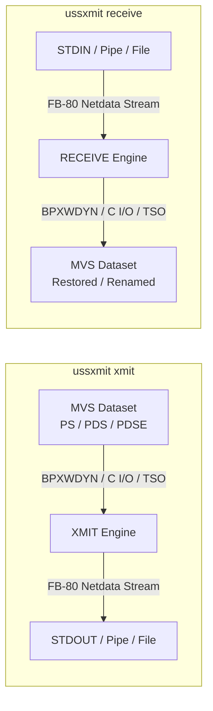
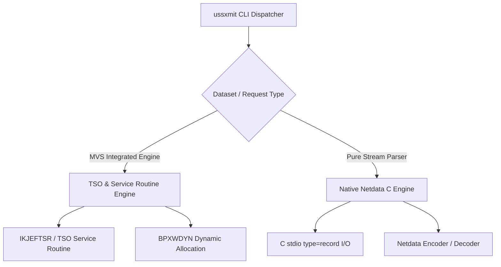

# Architecture & Technical Design: `ussxmit`

## 1. Architectural Goals & System Context

`ussxmit` provides native z/OS UNIX System Services (USS) command-line tooling to package datasets into standard TSO XMIT format and unpack XMIT data streams back into MVS datasets.



---

## 2. Command Line Interface Design

The single executable [`ussxmit`](src/main.c:1) inspects `argv[0]` or the first positional argument (`argv[1]`):

```
ussxmit <action> [options] [dsname]
```

### Action Dispatch Rules
1. **Direct Action Argument**:
   - `ussxmit xmit <source-dsn>`: Translates to XMIT generation mode.
   - `ussxmit receive [target-dsn]`: Translates to RECEIVE restoration mode.
2. **Symlink / Base Name Invocation**:
   - If `argv[0]` basename is `xmit`, defaults action to `xmit` and parses arguments from `argv[1]`.
   - If `argv[0]` basename is `receive`, defaults action to `receive` and parses arguments from `argv[1]`.
3. **Options**:
   - `-v`, `--verbose`: Enable verbose diagnostic logging to `stderr`.
   - `-q`, `--quiet`: Suppress non-error informational messages.
   - `-f`, `--force`: Overwrite existing target dataset on receive if already cataloged.
   - `-u`, `--unit <unit>`: Target DASD unit (default: `SYSALLDA` / system default).
   - `-s`, `--volume <volser>`: Target volume serial for dataset allocation.
   - `-h`, `--help`: Display synopsis and options.

---

## 3. The TSO XMIT / Netdata Format Specification

TSO XMIT uses the **IBM Netdata format** structured as fixed 80-byte physical records (`RECFM=FB`, `LRECL=80`).

### 3.1. Physical Record Framing & Segment Control
Each physical 80-byte record begins with a segment control header:
- **Byte 0**: Control byte / flag bits:
  - `0x00`: Normal segment start / standalone record.
  - `0x01`–`0xFF`: Segment flags (continuation flags, compression indicator, control vs data record).
- **Byte 1**: Segment length.
- **Bytes 2..79**: Payload or text unit structures.

### 3.2. Logical Control Records (EBCDIC Eyecatchers)

All control records are identified by a 6-byte EBCDIC eyecatcher:

| Identifier | Name | Purpose |
|:---|:---|:---|
| `INMR01` | Header Record | Origin node, user ID, target node, user ID, timestamp, transmission version, utility name (`IEBCOPY` for PDS). |
| `INMR02` | Dataset Utility Record | Dataset organization (`DSORG`), record format (`RECFM`), `LRECL`, `BLKSIZE`, allocation units, primary/secondary space, directory blocks, dataset name (`INMDSNAM`). |
| `INMR03` | User Control Record | Optional transmission messages, notes, and user-specified text units. |
| `INMR04` | Data Record | Contains actual payload chunks (either sequential file data or IEBCOPY unloaded dataset stream). |
| `INMR06` | Trailer Record | End-of-transmission delimiter; records total data record count and verification status. |
| `INMR07` | Acknowledgment Record | Transmission receipt notifications (network transmission). |

### 3.3. Text Units (KLD Structures)

Control records structure their attributes using Key-Length-Data (KLD) tuples:
- **Key** (2 bytes): Identifies the attribute (e.g., `INMDSNAM = 0x0002`, `INMLRECL = 0x0042`).
- **Count / Length** (2 bytes): Number of length-data pairs.
- **Length** (2 bytes): Length of the subsequent value.
- **Value** (`L` bytes): Variable length byte string / integer.

Common text unit keys defined in [`src/netdata/netdata.h`](src/netdata/netdata.h:1):
- `INMDSNAM` (`0x0002`): Dataset name.
- `INMMBR`   (`0x0003`): Member name.
- `INMDIR`   (`0x000B`): Directory block count (for PDS).
- `INMEXPDT` (`0x0022`): Expiration date.
- `INMTERM`  (`0x0028`): Terminal transmission flag.
- `INMUTILN` (`0x002B`): Utility program name (e.g. `INMCOPY` / `IEBCOPY`).
- `INMSIZE`  (`0x0030`): Dataset size estimate.
- `INMDSORG` (`0x003C`): Dataset organization (`0x4000` = PS, `0x0200` = PO).
- `INMRECFM` (`0x0049`): Record format (`0x80` = Fixed, `0x40` = Variable, `0x10` = Blocked, etc.).
- `INMLRECL` (`0x0042`): Logical record length.
- `INMBLKSIZE` (`0x0030`): Physical block size.

---

## 4. Execution Architecture

To support the full spectrum of dataset types (including complex PDS/PDSE load modules, program objects, aliases, SSI, and user data fields) alongside pure sequential files, `ussxmit` adopts a dual-engine architecture:



### 4.1. MVS Integrated Engine (TSO / IKJEFTSR & Dynamic Staging)
1. **`xmit` Operation**:
   - Generates a unique temporary staging dataset name: `&&XMIT.<pid>.<time>`.
   - Allocates the staging dataset via dynamic allocation (`BPXWDYN` with `alloc fi(SYSUT2) da(...) new space(10,50) cyl recfm(f,b) lrecl(80) blksize(3120)`).
   - Invokes TSO `TRANSMIT` through the `IKJEFTSR` service interface or background batch sub-environment (`XMIT dummy.dummy OUTDSNAME('TEMP.DSN') NOLOG DATASET('SOURCE.DSN')`).
   - Reads the 80-byte records sequentially from the staging dataset using C standard record I/O ([`fopen("//'TEMP.DSN'", "rb,type=record")`](src/io/dataset_io.c:45)).
   - Streams all 80-byte physical records directly to `stdout`.
   - Cleans up the temporary staging dataset via `BPXWDYN("free da(...) delete")`.

2. **`receive` Operation**:
   - Streams 80-byte chunks from `stdin` into a temporary staging dataset (`&&RCV.<pid>.<time>`) allocated via `BPXWDYN`.
   - Reads the `INMR01` and `INMR02` headers to determine the default dataset name if no target dataset was provided on the CLI.
   - Prepares the TSO `RECEIVE` command input stream (`RESTORE DATASET('TARGET.DSNAME')` or defaults).
   - Invokes `IKJEFTSR` to execute TSO `RECEIVE INDSNAME('TEMP.DSN')`.
   - Handles replacement flags (`-f` / `OLD` / `SHR` / `DELETE` before allocate).
   - Deletes the staging dataset after completion.

### 4.2. Native Stream Inspection & Unpack Engine
- Allows parsing the `INMR01` / `INMR02` metadata directly from `stdin` without needing disk staging for information queries (`--list` / `-l` mode to inspect archive contents and member lists).
- Direct extraction of sequential dataset records directly from `INMR04` payload blocks.

---

## 5. Character Set & Code Page Strategy

- **CLI & POSIX Environment**: The CLI runs in USS under ASCII or EBCDIC depending on the user's shell session tag and `_BPXK_AUTOCVT` environment.
- **Internal Representation**: Control record eyecatchers (`INMR01`, `INMR02`, etc.) and Text Unit descriptors on disk/stream are strictly IBM-1047 (EBCDIC).
- **String Conversion**:
  - The C code will compile cleanly in ASCII mode (`ibm-clang` / `xlc -fzos-le-char-mode=ascii`) or EBCDIC mode.
  - Conversion utilities in [`src/utils/ebcdic.c`](src/utils/ebcdic.c:1) ensure dataset names, volume serials, and member names are normalized and converted to/from IBM-1047 for MVS system services.

---

## 6. Error Handling & Exit Codes

| Return Code | Description |
|:---|:---|
| `0` | Success: dataset transmitted or received completely. |
| `1` | Invalid syntax or CLI arguments. |
| `2` | Source dataset not found or unable to be allocated. |
| `3` | Target dataset allocation / restore failure. |
| `4` | Corrupted XMIT data stream (invalid header or premature EOF). |
| `5` | TSO service (`IKJEFTSR` / `BPXWDYN`) execution error. |
| `6` | Permission / authorization failure (SAF / RACF violation). |
