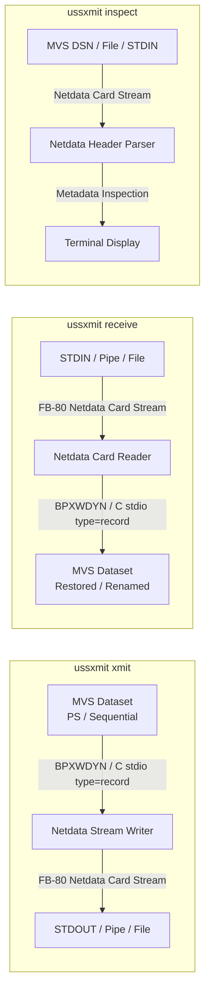
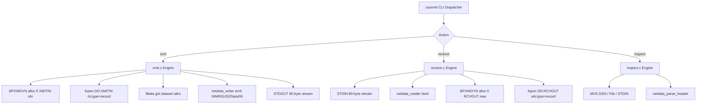

# Architecture & Technical Design: `ussxmit`

## 1. Architectural Goals & System Context

`ussxmit` provides native z/OS UNIX System Services (USS) command-line tooling to package datasets into standard TSO XMIT format and unpack XMIT data streams back into MVS datasets with **zero temporary DASD staging**.



---

## 2. Command Line Interface Design

The single executable [`ussxmit`](src/main.c:1) inspects `argv[0]` or the first positional argument (`argv[1]`):

```
ussxmit <action> [options] [dsname]
```

### Action Dispatch Rules
1. **Direct Action Argument**:
   - `ussxmit xmit <source-dsn>`: Translates to XMIT generation mode.
   - `ussxmit receive [target-dsn]`: Translates to RECEIVE restoration mode.
   - `ussxmit inspect [source-dsn]`: Translates to archive inspection mode.
2. **Symlink / Base Name Invocation**:
   - If `argv[0]` basename is `xmit`, defaults action to `xmit` and parses arguments from `argv[1]`.
   - If `argv[0]` basename is `receive`, defaults action to `receive` and parses arguments from `argv[1]`.
3. **Options**:
   - `-f`, `--force`: Overwrite existing target dataset on receive if already cataloged.
   - `-l`, `--list`: List/inspect metadata only (synonym for `inspect`).
   - `-v`, `--verbose`: Enable verbose diagnostic logging to `stderr`.
   - `-q`, `--quiet`: Suppress non-error informational messages.
   - `-h`, `--help`: Display synopsis and options.
   - `-V`, `--version`: Show version string.

---

## 3. The TSO XMIT / Netdata Format Specification

TSO XMIT archives use the **IBM Netdata format** structured as fixed 80-byte physical records (`RECFM=FB, LRECL=80`).

### 3.1. Physical Card Framing & Continuous Segment Packing
In standard Netdata format:
- Every physical record is an 80-byte card image.
- Data and control records are broken into segments. Each segment begins with a 2-byte header:
  - **Byte 0 (`seg_len`)**: Length of the segment (including the 2-byte header), from `2` up to `255`.
  - **Byte 1 (`flags`)**: Segment control flags.
  - **Bytes 2..(`seg_len` - 1)**: Segment payload.
- Segments are packed continuously across 80-byte card boundaries without inter-segment padding until the archive trailer or EOF.
- When the stream ends, the final 80-byte card is padded to column 80 with EBCDIC space (`0x40`) or binary zeros (`0x00`).

### 3.2. Segment Control Flags
The segment control byte governs record reassembly:
- `0x80`: First segment of a spanned logical record.
- `0x40`: Last segment of a spanned logical record.
- `0x20`: Control record indicator.
- `0xC0` (`0x80 | 0x40`): Complete standalone data record (single-segment logical record).
- `0xE0` (`0x80 | 0x40 | 0x20`): Complete standalone control record (`INMR01`, `INMR02`, `INMR06`).
- `0xA0` (`0x80 | 0x20`): First segment of a spanned control record.
- `0x60` (`0x40 | 0x20`): Last segment of a spanned control record.
- `0x00`: Middle segment of a spanned data record.

### 3.3. Logical Control Records (EBCDIC Eyecatchers)

All control records are identified by a 6-byte EBCDIC eyecatcher:

| Identifier | Name | Purpose |
|:---|:---|:---|
| `INMR01` | Header Record | Origin node, user ID, target node, user ID, timestamp, transmission version, utility name (`INMCOPY` / `IEBCOPY`). |
| `INMR02` | Dataset Utility Record | 4-byte file number (`0x00000001`), dataset organization (`INMDSORG`), record format (`INMRECFM`), `INMLRECL`, `INMBLKSIZE`, allocation units, directory blocks (`INMDIR`), dataset name qualifiers (`INMDSNAM`). |
| `INMR03` | User Control Record | Optional transmission messages, notes, and user-specified text units. |
| `INMR06` | Trailer Record | End-of-transmission delimiter; records total data record count. |

### 3.4. Text Units (KLD Structures)

Control records structure their attributes using Key-Length-Data (KLD) tuples:
- **Key** (2 bytes, big-endian): Identifies the attribute (e.g., `INMDSNAM = 0x0002`, `INMLRECL = 0x0042`).
- **Count** (2 bytes, big-endian): Number of length-data pairs.
- For each item:
  - **Length** (2 bytes, big-endian): Length of the subsequent value.
  - **Value** (`Length` bytes): Variable length byte string or integer.

Key text units defined in [`include/netdata.h`](include/netdata.h:1):
- `INMDSNAM` (`0x0002`): Dataset name qualifiers.
- `INMMBR`   (`0x0003`): Member name.
- `INMSECND` (`0x000B`): Secondary space quantity (defined, not used: TSO TRANSMIT does not send it).
- `INMDIR`   (`0x000C`): Directory block count (for PDS). Written by `xmit` for PDS (used directory blocks) and used by `receive` for `dir(n)`.
- `INMEXPDT` (`0x0022`): Expiration date.
- `INMTERM`  (`0x0028`): Terminal transmission flag.
- `INMUTILN` (`0x002B` / `0x1028`): Utility program name (`INMCOPY` / `IEBCOPY`).
- `INMSIZE`  (`0x102C`): Approximate file size in bytes (4 bytes; `0` = unknown). Written by `xmit` and used by `receive` to size the target allocation. TSO TRANSMIT reports used tracks x track capacity (sequential: blocks per track x `BLKSIZE`; PDS: 58786 bytes per 3390 track), so it is an upper bound of the data; `xmit` reports records x `LRECL` for sequential datasets and, for a PDS, the directory plus every member rounded up to whole blocks.
- `INMLSIZE` (`0x8018`): File size in megabytes (4 bytes), written instead of `INMSIZE` above 4 GB; `receive` multiplies by 1 MB when `INMSIZE` is absent.
- `INMDSORG` (`0x003C`): Dataset organization (`0x4000` = PS, `0x0200` = PO).
- `INMRECFM` (`0x0049`): Record format (`0x80` = Fixed, `0x40` = Variable, `0x10` = Blocked, etc.).
- `INMLRECL` (`0x0042`): Logical record length.
- `INMBLKSIZE` (`0x0030`): Physical block size.

---

### 3.5. IEBCOPY Unload Stream of a PDS (as produced by TSO TRANSMIT)

Record order: `INMR01`, `INMR02` (IEBCOPY), `INMR02` (INMCOPY), `INMR03`, then data records, `INMR06`. The data records carry the byte stream `COPYR1`, `COPYR2`, directory units, member units.

- **COPYR1** (56 bytes): `00CA6D0F`, DSORG, BLKSIZE, LRECL, RECFM, key length, unload block size 3120 at offset 14, UCB type `3030200F`, heads (15) at 26, track bytes 58786 at 28, DS1DSIND/SCAL/LSTAR at 42-51.
- **COPYR2** (276 bytes): extent count, DEB prefix, then 16-byte extent entries from 0x10 (start CCHH at +6, end CCHH at +10, track count at +14).
- **Directory unit** (276 bytes): 12-byte count field (`00000000 00 00000000 08 0100`), 8-byte key (highest name of the block, `FF` x 8 for the last), 256-byte block. One 12-byte zero count field ends the directory.
- **Member unit**: `[00 EE 00 00][CCHH][R][len(3)]` + the raw physical block. `EE` is the 0-based extent index. A member ends with a zero-length header. The first block R is the directory R; R then increments and resets to 1 on a new track.
- Units are packed into logical records freely (a directory is one record; a short last block carries the EOF header, see 4.1).
- Verification technique: reload the stream with plain IEBCOPY (`COPY INDD=unload,OUTDD=pds`, unload dataset `RECFM=VS LRECL=32756 BLKSIZE=3120`) to see IEBCOPY's own diagnostics, which real RECEIVE hides.

### 3.6. IEBCOPY Unload Stream of a PDSE

TSO TRANSMIT of a PDSE (data library or program-object library) uses the same framing as a PDS (`COPYR1`, `COPYR2`, directory units, terminator) but the content differs; decoded from real streams (`TS48072.SIBMZCMP`, a program library with 10 members, RECFM U, 111 MB).

- **COPYR1 byte 0**: `0x00` PDS, `0x01` PDSE data library, `0x11` PDSE program-object library. Detection: `(byte0 & 0x11) != 0`.
- **INMR02 `INMTYPE` (`0x8012`)**: `0x00` PDS, `0x80` data library, `0x40` program library. `INMLRECL` 0 and `INMRECFM` `0xC000` for RECFM U. `INMSIZE` is the allocated size of the PDSE, not the stream size.
- Directory units are 276 bytes as for a PDS, but the count field starts with `0x08`; the directory ends with a 12-byte terminator that starts with `0x88`.
- The member data are no DASD track images. Per member there are two groups of units: (A) data blocks with header flag `0x00`, ended by a terminator with flag `0x80`; (B) an `IGWFAHR` attribute record with header flag `0x04`, ended by a terminator with flag `0x84`. Program objects use 4096-byte `IEWPLMH` pages. A data PDSE has a trailing dataset-level record with flag `0x02`, ended by `0xC2`.
- Program-object libraries (`0x11`, RECFM U) are only produced and consumed reliably by IEBCOPY, so `ussxmit` does not interpret them: the stream records are the records of an IEBCOPY unload data set (`RECFM=VS LRECL=32756 BLKSIZE=3120`) passed through unchanged (see 4.1/4.2).

#### Data PDSE layout (handled natively since 1.5.0)

Verified byte for byte against IEBCOPY output for FB, VB, ISPF statistics, aliases, empty members and a 1375 member library.

- **Records**: `COPYR1` (56), `COPYR2` (276), directory units (276 each, count field byte 0 `0x08`), 12-byte terminator `88 00 ...`. Then per non-alias member in ascending TTR order: data units (flag `0x00`), end marker (`0x80`, length 0), attribute unit (`0x04`, 279 bytes), end marker (`0x84`). After the last member a dataset unit (`0x02`, 160 bytes) and a `0xC2` marker, both carrying the last member's TTR. A trailing `0x40` run is netdata card padding.
- **Unit header** (12 bytes): `[flag][00 00 00][00 00 TT(2)][R][len(3)]`. The CCHH field holds the TT part of the member id, the R byte the R part.
- **Member id**: IEBCOPY numbers the members `2 x directory TTR + 1` (24 bit). The directory entries of an unload carry that id instead of the TTR the DD read gives.
- **Directory**: `fopen("DD:PDSDIR","rb,type=record")` on a PDSE returns the PDS entry layout. For the unload the used count of the last block stops right after the 8-byte `FF` end marker, followed by `00 00 01 00` (marker TTR 0 mapped like a member id), and all bytes past the used count are zeroed. Aliases carry the primary member's id and have no data units. ISPF statistics are directory user data.
- **Constants**: `COPYR1`, `COPYR2` and the 279/160 byte attribute units are the same for every data PDSE ([`include/pdse_unload.h`](include/pdse_unload.h:1)); only `COPYR1` bytes 4-10 vary (DSORG, BLKSIZE, LRECL, RECFM). They do not depend on RECFM, LRECL, ISPF statistics or aliases.
- **Member data**: `fopen("DD:MBRDD","rb,type=blocked")` + `fread` returns exactly the unloaded blocks (BLKSIZE-filled, short last block; VB blocks with BDW/RDW).

## 4. Pure In-Process Execution Architecture

`ussxmit` eliminates scratch disk staging by combining dynamic allocation with native C record I/O and continuous stream encoding:



### 4.1. `xmit` Operation
1. Normalizes the source dataset name (`CCW.TESTSEQ` -> `CCW.TESTSEQ`).
2. Calls `dynalloc_str("alloc fi(XMITIN) da('...') shr")` to dynamically allocate the dataset via SVC 6 `BPXWDYN`.
3. Opens the dataset using `fopen("DD:XMITIN", "rb,type=record")` for native binary record I/O.
4. Queries dataset characteristics using `fldata()` to extract `dsorg`, `recfm`, `maxreclen`, and `blksize`.
5. **Sequential Datasets (`DSORG=PS`)**:
   - Seeks to the end of the record stream (`fseek`/`ftell`, O(1) on z/OS) to learn the record count, rewinds, and derives `INMSIZE` = records x `LRECL`.
   - Emits `INMR01` and `INMR02` (`INMUTILN = INMCOPY`, `INMSIZE` set).
   - Reads records sequentially via `fread()` and emits Netdata data records (spanned if >253 bytes).
   - Emits `INMR06` trailer, flushes, and frees DD.
6. **Partitioned Datasets (`DSORG=PO` — PDS & PDSE)** ([`src/pds_xmit.c`](src/pds_xmit.c:1)):
   - Reads 256-byte directory blocks from `fopen("DD:PDSDIR", "rb,type=record")`.
   - Parses member entries, TTRs, user data (ISPF stats, program object metadata), and ALIAS flags (`C & 0x80`).
   - Probes the first member via `fldata()` to extract exact dataset `RECFM`, `LRECL`, and `BLKSIZE`.
   - Emits `INMR01` and `INMR02` (`INMUTILN = IEBCOPY`, `INMDSORG = 0x0200`, `INMSIZE` and `INMDIR` set). The size comes from a pre-pass that seeks to the end of every non-alias member (`fseek`/`ftell` returns the record count) and sums `ceil(records x LRECL / BLKSIZE) x BLKSIZE` plus the directory.
   - Emits two `INMR02` records and an `INMR03`, as TSO TRANSMIT does: `IEBCOPY` (the PDS) and `INMCOPY` (the intermediate unload dataset, VBS 32756/3120).
   - Emits the IEBCOPY unload stream (format decoded from real TRANSMIT output, see 3.5): `COPYR1` (56 bytes, 3390 geometry), `COPYR2` (276 bytes, one virtual extent), the used directory blocks, then member data.
   - Members are written in physical order (directory TTR). Each physical block is read raw with `fopen(..., "rb,type=blocked")` and sent as `[12-byte header][block incl. BDW/RDW]`; the header holds the CCHHR derived from the directory TTR and a 3390 track simulation. A member ends with a 12-byte zero-length header. Aliases are kept in the directory and skipped for data.
   - The member EOF header rides with the last block only if the record stays within `min(source BLKSIZE, 3120)`; otherwise (and for empty members) it is a record of its own. Real IEBCOPY reload rejects streams that attach it to a full-size block (IEB188I, RC 8).
   - Emits `INMR06` trailer, flushes, and frees DDs.

7. **PDSE (`fldata().__dsorgPDSE`)**:
   - **Data library, native** ([`src/pds_xmit.c`](src/pds_xmit.c:1) `xmit_pds_stream` with `pdse`, 1.5.0): the stream of 3.6 is built directly from the directory and member reads, no IEBCOPY and no temporary DASD. `INMTYPE` is `0x80`. The result is byte identical to the IEBCOPY stream. It returns `XMIT_FALLBACK` (before any output) when the first-member probe shows RECFM U, the library has no members, or the member/directory buffers are full; `xmit.c` then uses the IEBCOPY path below. `USSXMIT_IEBCOPY=1` forces the IEBCOPY path.
   - **IEBCOPY path** ([`src/pds_xmit.c`](src/pds_xmit.c:1) `xmit_pdse_stream`, [`src/iebcopy.c`](src/iebcopy.c:1)), used for program-object libraries and as fallback:
     - Allocates a temporary unload data set (`<HLQ>.XMUNL.*`, VS 32756/3120) and runs IEBCOPY `COPY` from the PDSE into it.
     - IEBCOPY is authorized (AC=1): LINKing it through SVC 6 from a USS process kills the process (SIGKILL). It runs under the TSO terminal monitor program instead: `tsocmd "EXEC 'tmp.rexx' EXEC"`, where a temporary REXX exec allocates `SYSUT1/SYSUT2/SYSIN/SYSPRINT`, `CALL`s `SYS1.LINKLIB(IEBCOPY)` and frees the DDs. (Allocations made by separate `tsocmd` calls do not persist, hence the exec.) The SYSPRINT data set is read back; its `IEB147I ... HIGHEST SEVERITY CODE` is the return code (0 and 4 succeed).
     - Reads COPYR1 for DSORG/RECFM/LRECL/BLKSIZE and the library type (`INMTYPE` 0x80 or 0x40), sums the record lengths for `INMSIZE`, emits `INMR01`, `INMR02` (IEBCOPY), `INMR02` (INMCOPY), `INMR03`, then every unload record unchanged as a data record, then `INMR06`. The temporary data sets (unload, exec, SYSIN, SYSPRINT) are deleted.
     - Only this path uses temporary DASD.

### 4.2. `receive` Operation
1. Initializes `netdata_reader_t` with record dispatcher callback `receive_record_cb`.
2. Reads 80-byte card images from `stdin`.
3. Reassembles continuous segments and spanned records.
4. On `INMR02`:
   - Decodes text units (`INMDSNAM`, `INMDSORG`, `INMRECFM`, `INMLRECL`, `INMBLKSIZE`, `INMSIZE`, `INMDIR`).
   - Resolves target dataset name (command-line override or embedded dataset name).
   - If `-f` / `--force` specified, invokes `dynalloc_delete_dsn()` to delete existing cataloged dataset.
   - Dynamically allocates target dataset via `BPXWDYN` (adding `dir(...)` for PDS). Space is sized like TSO RECEIVE:
     - `INMSIZE` > 0: `block(BLKSIZE) space(size/BLKSIZE, size/BLKSIZE/4) release` (primary from the sender's size, secondaries for underestimates, unused space released on close).
     - `INMSIZE` absent or 0 (XMIT370 streams): `cyl space(1,500) release`.
     - PDS/PDSE use the same rules; `dir(INMDIR)` (default 20 blocks without `INMDIR`).
     - TSO streams of a PDS carry two `INMR02` records (`IEBCOPY` describing the PDS, then `INMCOPY` describing the intermediate unload dataset); only the first is used.
     - The constants are `RECV_*` macros in [`src/receive.c`](src/receive.c:1).
5. **Sequential Restoration (`DSORG=PS`)**:
   - Opens target via `fopen("DD:RCVOUT", "wb,type=record")` and writes records directly.
6. **Partitioned Restoration (`DSORG=PO`)** ([`src/receive.c`](src/receive.c:1)):
   - After `COPYR1` and `COPYR2`, the directory units (276 bytes: count field, 8-byte key, 256-byte block; a zero count field ends the directory) and the member units (12-byte header + raw block) are decoded as one continuous byte stream, because TSO packs units into records at arbitrary boundaries.
   - A member is selected by the header CCHHR (relative track through the `COPYR2` extents, with the heads count from `COPYR1`) matched to the directory TTR; fallback is the next unfinished member in directory order.
   - Raw blocks are decoded per RECFM: U one record per block, V through BDW/RDW, F split by LRECL.
   - A zero-length header ends the member: the member file is closed and its DD freed.
7. **PDSE restoration** (`COPYR1` byte 0 has bit `0x11`; [`src/receive.c`](src/receive.c:1), [`src/iebcopy.c`](src/iebcopy.c:1)):
   - The `PO` target allocation is deferred until `COPYR1` has been seen: a PDSE stream allocates the target with `dsntype(library)` (RECFM U without `lrecl`).
   - **Native** (1.5.0): a data library (`COPYR1` byte 0 `0x01`, not RECFM U, `USSXMIT_IEBCOPY` unset) is written member by member like a PDS. The member is found by the header's member id (TT, R) against the directory TTRs; a `0x80` marker completes it (and creates an empty member), `0x04`/`0x02` units are skipped, `0xC2` ends the data. At `INMR06` the member count must match the directory, otherwise exit 4.
   - **Switch to IEBCOPY**: writing members with `fopen` cannot recreate aliases or ISPF statistics. The records up to the end of the directory are therefore buffered; if the directory has an alias or user data, they are replayed into a temporary unload data set and the rest of the stream follows unchanged (IEBCOPY path below). Otherwise the buffer is dropped.
   - **IEBCOPY path** (program-object libraries, switch, override): all data records go unchanged to a temporary unload data set (`<HLQ>.UNLD.*`, VS 32756/3120); on `INMR06` IEBCOPY copies it into the new PDSE (same `tsocmd`/REXX mechanism as `xmit`, see 4.1); a return code above 4 gives exit code 5. The temporary data set is deleted.
   - Outside the IEBCOPY path, a data block without an owning member is an error (exit 4), not a warning.
8. On `INMR06`: closes all open handles and frees allocated DDs.

### 4.3. `inspect` Operation
1. Accepts input from an MVS dataset name (e.g. `ussxmit inspect "CCW.TESTPDS.XMI"`), a local file, or `stdin`.
2. Reads archive header blocks into `netdata_reader`.
3. Decodes `INMR01` and `INMR02` text units.
4. Prints formatted metadata to standard output:
   - Dataset name and member name (if single-member transmit).
   - Organization (`PS`, `PO`, `DA`).
   - Record format (`FB`, `VB`, `U`, etc.).
   - Logical record length (`LRECL`) and Block size (`BLKSIZE`).
   - Approximate size in bytes (`INMSIZE`, when non-zero).
   - Directory blocks (for PDS).
   - Utility name (`INMCOPY` / `IEBCOPY`).
   - Origin node and user ID.
   - Archive timestamp (`YYYY-MM-DD HH:MM:SS`).

---

## 5. Character Set & Code Page Strategy

- **CLI & POSIX Environment**: The CLI runs under ASCII (`ibm-clang` / `clang`) or native EBCDIC environments.
- **Internal Representation**: Control record eyecatchers (`INMR01`, `INMR02`, etc.) and Netdata text units are strictly IBM-1047 EBCDIC.
- **Translation Tables**: Bidirectional conversion functions `a2e_mem()` / `e2a_mem()` and `a2e_str()` / `e2a_str()` in [`src/utils.c`](src/utils.c:1) ensure dataset names, qualifiers, node names, and timestamps are translated cleanly.

---

## 6. Error Handling & Exit Codes

| Return Code | Constant | Description |
|:---|:---|:---|
| `0` | `RC_SUCCESS` | Success: operation completed cleanly. |
| `1` | `RC_ERR_SYNTAX` | Invalid CLI syntax or options. |
| `2` | `RC_ERR_ALLOC_SRC` | Source dataset not found or unable to allocate. |
| `3` | `RC_ERR_ALLOC_TGT` | Target dataset allocation or open failure. |
| `4` | `RC_ERR_STREAM` | Corrupted Netdata stream or truncated header. |
| `5` | `RC_ERR_INTERNAL` | System service or internal processing failure. |
